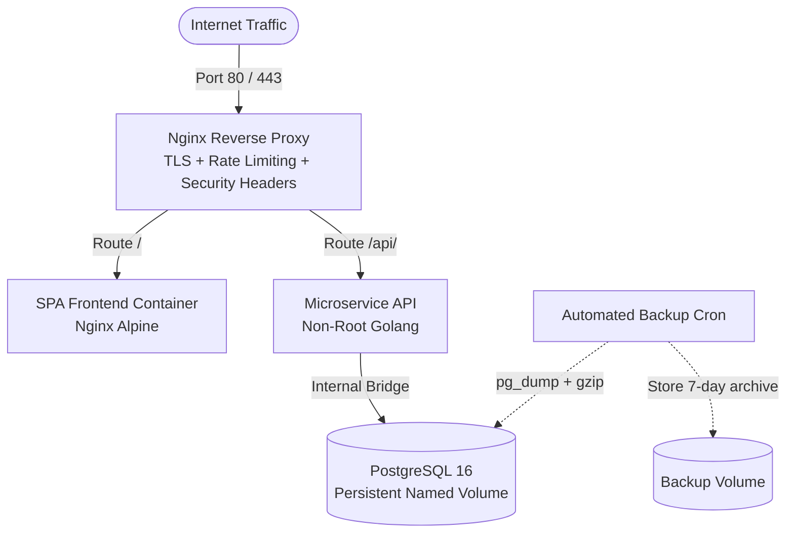

Enterprise Production-Ready Docker Suite


A containerized microservice foundation designed for production deployments on a VPS (AWS EC2, DigitalOcean, Hetzner, Linode). It combines a hardened Nginx reverse proxy, a Go API, a SPA frontend, PostgreSQL 16 and an automated backup service in a single Docker Compose stack.
Table of Contents
Architecture
Key Features
Prerequisites
Project Structure
Getting Started
Configuration
Enabling HTTPS
Backup & Restore
Endpoints
Security Notes
Useful Commands
License
Architecture

Only the Nginx container is exposed to the host. The frontend, backend, database and backup service communicate over an internal Docker bridge network and are not reachable from the internet.
Key Features
Edge Reverse Proxy: Nginx with request rate limiting, Gzip compression and strict security headers (HSTS, CSP, X-Frame-Options, X-Content-Type-Options).
Minimal Attack Surface: Multi-stage builds produce small images; all application containers run as a non-root user (UID 10001).
Network Isolation: The database is only reachable from the backend over an internal network.
Automated Backups: A dedicated service runs compressed `pg_dump` backups on a schedule and keeps the last 7 days.
Persistent Data: Named Docker volumes for database data and backups survive container restarts and rebuilds.
Health Checks: Container health checks let Docker restart unhealthy services automatically.
Prerequisites
Requirement	Version
Docker Engine	24.0 or newer
Docker Compose plugin	v2.20 or newer (`docker compose`, not `docker-compose`)
OS	Any Linux distribution (Ubuntu 22.04 / 24.04 recommended)
Open ports	80 and 443
Check your versions:
```bash
docker --version
docker compose version
```
Project Structure
```text
.
├── backend/              # Go API source code and Dockerfile
├── frontend/             # SPA frontend source code and Dockerfile
├── nginx/
│   ├── nginx.conf        # Reverse proxy, rate limiting and security headers
│   └── certs/            # TLS certificates (not committed to git)
├── backup/
│   ├── Dockerfile        # Backup service image
│   └── backup.sh         # pg_dump + gzip + 7-day retention script
├── docker-compose.yml    # Full production stack
├── .env.example          # Environment variable template
└── README.md
```
Getting Started
1. Clone the repository
```bash
git clone https://github.com/<your-username>/<your-repo>.git
cd <your-repo>
```
2. Create the environment file
```bash
cp .env.example .env
```
Open `.env` and set strong values, at minimum for `POSTGRES_PASSWORD` (see Configuration).
3. Start the stack
```bash
docker compose up -d --build
```
4. Verify that everything is running
```bash
docker compose ps
curl http://localhost/api/v1/health
```
Configuration
All settings are read from the `.env` file.
Variable	Description	Example	Required
`POSTGRES_USER`	Database user	`app_user`	Yes
`POSTGRES_PASSWORD`	Database password, must be changed	`a-long-random-string`	Yes
`POSTGRES_DB`	Database name	`app_db`	Yes
`BACKEND_PORT`	Internal port of the Go API	`8080`	No
`BACKUP_SCHEDULE`	Cron expression for automatic backups	`0 3 * * *` (daily at 03:00)	No
`BACKUP_RETENTION_DAYS`	How many days of backups to keep	`7`	No
`DOMAIN`	Public domain name, used for HTTPS	`example.com`	For HTTPS
> **Important:** Never commit the `.env` file. Make sure it is listed in `.gitignore`.
Generate a strong password:
```bash
openssl rand -base64 32
```
Enabling HTTPS
Running production traffic over plain HTTP is not recommended. The simplest option is a free certificate from Let's Encrypt:
Point your domain's DNS `A` record to the server's IP address.
Obtain a certificate with Certbot:
```bash
   sudo apt install certbot
   sudo certbot certonly --standalone -d example.com
   ```
Copy or mount the certificates into `nginx/certs/` and enable the `listen 443 ssl;` server block in `nginx/nginx.conf`.
Redirect all HTTP traffic to HTTPS and restart Nginx:
```bash
   docker compose restart nginx
   ```
Let's Encrypt certificates expire after 90 days, so set up automatic renewal (`certbot renew`) with a cron job or systemd timer.
Backup & Restore
Automatic backups
The `backup-service` creates a compressed dump (`.sql.gz`) of the database on the schedule set in `BACKUP_SCHEDULE` and deletes backups older than `BACKUP_RETENTION_DAYS`.
Create a backup manually
```bash
docker compose run --rm backup-service
```
List existing backups
```bash
docker compose run --rm --entrypoint sh backup-service -c "ls -lh /backups"
```
Restore a backup
> **Warning:** Restoring overwrites the current data. Create a fresh backup first.
Stop the backend so no new data is written:
```bash
   docker compose stop backend
   ```
Restore the chosen file (replace `<backup-file>` with a name from the list):
```bash
   docker compose run --rm --entrypoint sh backup-service -c "gunzip -c /backups/<backup-file>.sql.gz" \
     | docker compose exec -T db sh -c 'psql -U "$POSTGRES_USER" -d "$POSTGRES_DB"'
   ```
Start the backend again:
```bash
   docker compose start backend
   ```
Off-site copies
Backups stored on the same server are lost if the server is lost. For real disaster recovery, regularly copy the backup files to external storage (for example AWS S3, Backblaze B2 or another server).
Endpoints
Service	URL
Web App UI	`http://localhost/`
Healthcheck API	`http://localhost/api/v1/health`
Security Notes
Change all default passwords in `.env` before the first deployment.
Only ports 80 and 443 should be open. Restrict SSH access and use a firewall (for example `ufw`).
Nginx rate limiting protects against brute-force attempts and simple request floods. It is not a substitute for a dedicated DDoS protection service such as Cloudflare.
Keep base images up to date and rebuild regularly:
```bash
  docker compose pull
  docker compose up -d --build
  ```
Useful Commands
Task	Command
Show running containers	`docker compose ps`
Follow logs of all services	`docker compose logs -f`
Follow logs of one service	`docker compose logs -f backend`
Restart a service	`docker compose restart nginx`
Stop the stack	`docker compose down`
Stop and delete all data	`docker compose down -v`
License
This project is licensed under the MIT License. See the LICENSE file for details.
